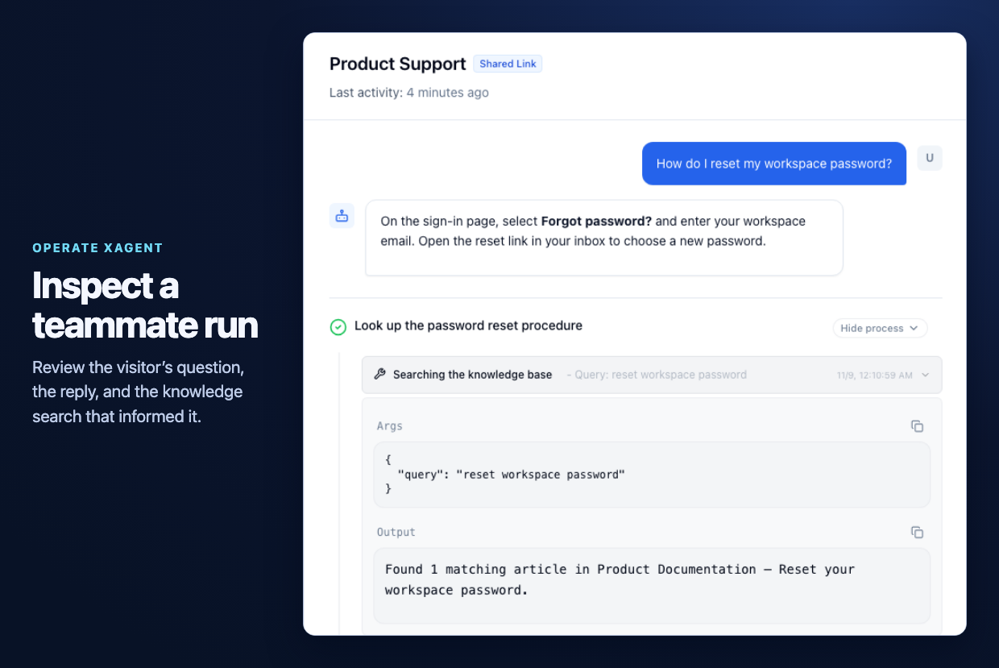

Use **Conversation Logs** to see how a deployed teammate handled an end-user request. The page covers conversations from Shareable Link, Widget, REST API, and Webhook. For tasks you start in the workspace, open the task from your task history.

## Find a run

1. Open **Conversation Logs** from the sidebar.
2. Select the entry point, such as **Shareable Link**, and filter by teammate. You can also search the list.
3. Select a conversation. Review the visitor's message, the teammate's reply, and the recorded execution steps.

Administrators can inspect external conversations across users. Other users see their own external conversation logs.

## Inspect a tool call

In this example, a visitor asks the **Product Support** teammate how to reset a workspace password.

1. Find the question and reply in the transcript.
2. Select **Show process** to view the execution steps when trace data is available.
3. Expand the knowledge search to check its query and result. If the search returned the wrong document, check the attached knowledge base and test the question again in Preview.

<Frame caption="Example Product Support run showing a visitor's question and the knowledge search.">
  
</Frame>

Trace data can expire separately from the transcript. When trace data is available, the detail view shows the recorded calls and results for that run.

## Related guides

- [Deploy for end users](/agents/sharing)
- [Task execution](/tasks/execution)
- [Self-host Xagent](/deployment/self-hosted)
