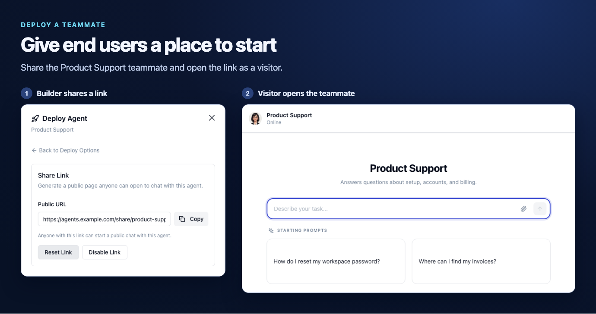

Open Xagent, describe a task in the workspace, and run it. For recurring work, [add a preconfigured teammate](/templates/overview) or build your own. Publish a teammate when you want other people to use it.

## Why choose Xagent?

Run a real task in the workspace, then configure a specialist for recurring work. A published teammate can take tasks in the workspace, join a Workforce, or serve end users. After deployment, use Conversation Logs to inspect the transcript and recorded tool calls.

## What is a teammate?

A teammate is a reusable agent configured for a specific job. Give it instructions, a model, skills, tools, and knowledge. For example, a **Product Support** teammate can answer setup and billing questions using the product documentation you attach.

<Frame caption="A published Product Support teammate and the page a visitor opens from its shareable link.">
  
</Frame>

## How to get started

<Columns cols={2}>
  <Card title="Run a task" icon="play" href="/quickstart#run-your-first-task">
    Set up a model and send your first request from the workspace.
  </Card>
  <Card title="Build a teammate" icon="robot" href="/agents/building">
    Configure a specialist for a job and test it in Preview.
  </Card>
  <Card title="Deploy for end users" icon="share" href="/agents/sharing">
    Give people access through a shareable link, widget, or API integration.
  </Card>
  <Card title="Operate Xagent" icon="chart-line" href="/deployment/conversation-logs">
    Inspect deployed conversations, transcripts, and recorded tool calls.
  </Card>
</Columns>

