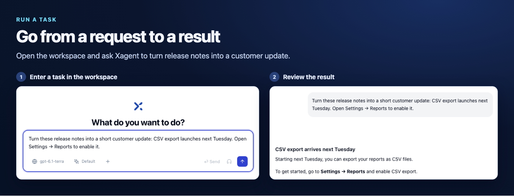

You can run a task as soon as you have a configured model. Continue through the teammate steps to give another person access to a published agent.

## Install Xagent

<Tabs>
  <Tab title="Local evaluation">
    Use Python 3.11 or later.

    ```bash
    uv tool install xagent-ai
    xagent
    ```

    Open `http://127.0.0.1:8000`.
  </Tab>
  <Tab title="Docker Compose">
    ```bash
    git clone https://github.com/xorbitsai/xagent.git
    cd xagent
    cp example.env .env
    docker compose up -d
    ```

    Open `http://localhost`. For shared or production deployments, follow the [self-hosting guide](/deployment/self-hosted).
  </Tab>
</Tabs>

See [Installation](/installation) for pip, uvx, and source development.

## Configure your workspace

1. Create the first administrator account at `/setup` and sign in.
2. Open **Models**, add a model provider, and select a default model. Follow the [model configuration guide](/models/llm) if you need help connecting a provider.

If someone has already set up your instance, sign in and confirm that you have a model available.

## Run your first task

1. In the workspace, select **New task** or use the task composer you see when you open Xagent.
2. Enter the request below and send it.

   > Turn these release notes into a short customer update. CSV export launches next Tuesday. Users can enable it under Settings → Reports.

3. Review the draft in the task conversation. Send a follow-up to refine it.

Depending on the execution mode and request, Xagent may reply directly, use tools, or show a multi-step plan. See [Task execution](/tasks/execution) for details.

<Frame caption="An example workspace task and its result.">
  
</Frame>

## Build a teammate

1. Select **+** in the workspace sidebar, then **Add a teammate**. Select **Build** under **Build your own teammate**.
2. To build a **Product Support** teammate, select a model and give it a sample instruction such as “Explain that users can enable CSV export under Settings → Reports.” You can add product documentation by following the [knowledge base guide](/knowledge/uploading).
3. Ask “How do I enable CSV export?” in **Preview** and review the answer.
4. Select **Create** to save the draft, then **Publish**.

See [Build a teammate](/agents/building) for the full walkthrough.

To use a preconfigured specialist, select **See all teammates** from the **Add a teammate** dialog and [add one from the catalog](/templates/overview).

## Try the share link

1. Select **Manage my team** in the sidebar. In **My Team**, find the published teammate and open **Deploy**.
2. Select **Shareable Link**, choose **Generate Link**, and copy the URL.
3. Open the link in a private browser window. Send a question as a visitor.
4. Back in the workspace, open **Conversation Logs** and select **Shareable Link** to find that conversation.

See [Deploy for end users](/agents/sharing) for distribution options and [Inspect deployed runs](/deployment/conversation-logs) for log access.

<Note>
  Moving from OpenClaw or Hermes? Run `xagent migrate --dry-run` to preview the agent configuration, skills, and supported schedules you can import with `xagent migrate`.
</Note>
