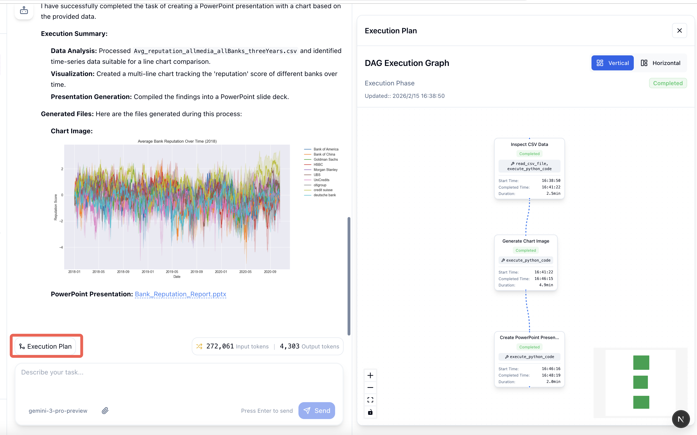

Choose an execution mode in the workspace when you start a task. If you select a teammate, Xagent uses its configured execution mode.

## Execution modes

| Workspace mode | What Xagent does |
| --- | --- |
| **Auto** | Chooses whether to answer directly, use tools, or create and execute a plan |
| **Flash** | Answers directly or uses tools and then moves to a final answer |
| **Balanced** | Uses a reasoning and tool-use loop to work through the request |
| **Think** | Builds a plan and runs its steps in dependency order |

**Default** uses your deployment's configured mode, which is normally **Auto** for a standalone task. Choose **Think** when you want a multi-step plan.

## Follow a run

The task conversation shows your request and the output. The execution details depend on the mode and the work the model performs.

- **Direct answer.** Read the answer in the conversation.
- **Tool use.** Expand the recorded execution details to inspect tool calls and results when available.
- **Planned execution.** Open **Progress** to inspect the planned steps and their status. Steps with no unmet dependencies can run concurrently.

In a plan, nodes represent steps and edges represent dependencies between them.

## Continue or revisit a task

Send a follow-up to refine the result or provide more context. You can attach files to a request when the composer allows attachments. Use the available task controls to stop, pause, or resume a run when applicable.

Open a past task from task history to review the conversation and retained execution details. For end-user requests made through a deployed teammate, use [Conversation Logs](/deployment/conversation-logs).

## Troubleshooting

- **The task does not start.** Check the selected model, provider credentials, and available quota.
- **A tool fails.** Inspect the recorded error and check the tool's settings or authorization.
- **The task has no plan view.** Check the selected mode. Direct answers and tool-use loops can complete without generating a plan.

## Next steps

- [Run your first task](/quickstart#run-your-first-task)
- [Build a teammate](/agents/building)
- [Inspect deployed runs](/deployment/conversation-logs)
