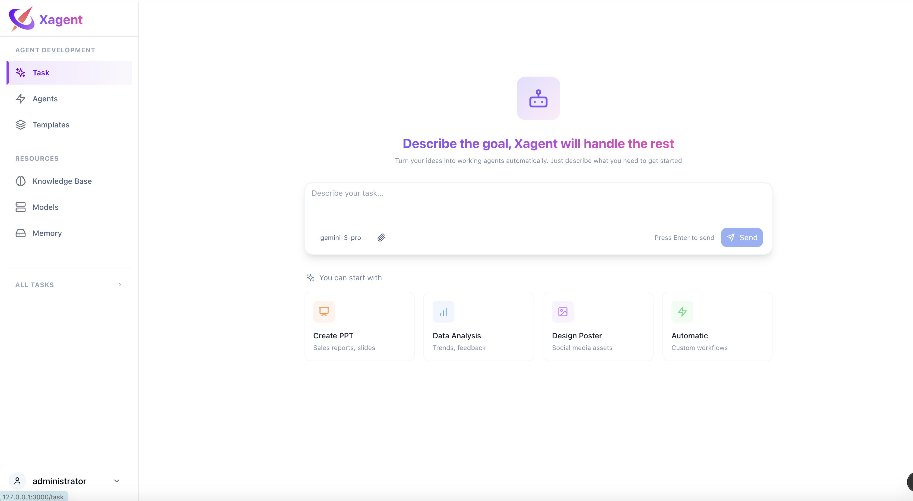
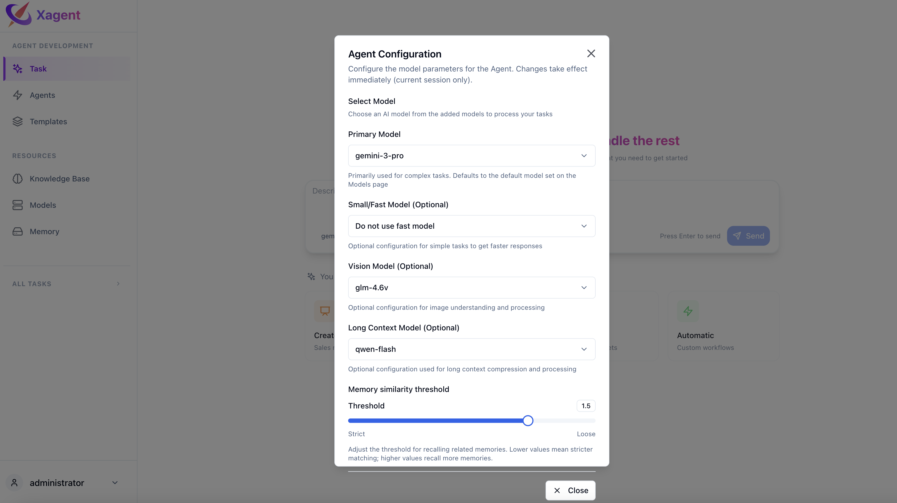

# Tasks Overview

A task is a request you run in the Xagent workspace. Start with **New task**, enter your request, and send it. You can also select a teammate to use its saved configuration.

## What is a Task?

Describe the outcome you want and add files if they provide context. Xagent can answer directly, use tools, or plan multiple steps depending on the request and the execution mode.

### Task Examples

```bash
# Research
"Research the latest AI developments and write a summary"

# Presentations
"Create a 10-slide presentation about renewable energy"

# Design
"Design a promotional poster for a coffee shop"
```

## Task Configuration

Before running a task, you can configure the model settings.



### Model Selection

Choose the appropriate model for your task:

**Main Model** - Used for all task execution by default
- Required for all tasks
- Handles planning, reasoning, and execution
- Used unless fast model is configured

**Fast Model** - Used for simple steps (optional)
- Automatically used for steps identified as simple during planning
- Reduces cost and improves speed for routine operations
- If not configured, main model handles all steps

**Other Model Types**:
- [Long Context Models](/models/llm) - For compressing large context windows
- [Vision models](/models/llm) - For image understanding

**Model Settings**:
- Select from configured providers
- Adjust temperature for creativity
- Set max tokens for output length
- Configure other model parameters



## Key Features

### Natural Language Input

Describe your goal in plain language - no coding or workflow design required. Xagent understands context and intent.

### File Attachments

Upload files to provide context for your tasks:
- Documents (PDF, DOCX, TXT)
- Spreadsheets (CSV, XLSX)
- Images (PNG, JPG)
- Code files
- And more

### Real-time Execution

Watch your task execute in real-time:
- See each step as it's planned
- Monitor execution progress
- View intermediate results
- Iterate on the output

### Streaming Responses

Get results as they're generated, not just at the end. Perfect for long-running tasks where you want to see progress.

## How It Works

<Steps>
  <Step>
    Submit your task
    Describe your goal in natural language through the Task page
  </Step>
  <Step>
    Configure model (optional)
    Select main model and fast model for the task
  </Step>
  <Step>
    Run the task
    Xagent runs the request using the selected execution mode.
  </Step>
  <Step>
    Follow the run
    When Xagent uses tools or creates a plan, open the available execution details to follow its progress.
  </Step>
  <Step>
    Results delivered
    Receive the final output with the ability to iterate or refine
  </Step>
</Steps>

## Task Interface

The task interface provides:

- **Chat Input**: Natural language input area
- **Model Selector**: Choose models for this task
- **File Upload**: Attach files for context
- **Execution View**: Watch your task progress in vertical step flow
- **Results Panel**: Review outputs and artifacts

## Next Steps

- [Learn about task execution](/tasks/execution) - See how tasks execute step-by-step
- [Build a teammate](/agents/building) - Configure a specialist for recurring work
- [LLM Models](/models/llm) - Set up and configure language models
